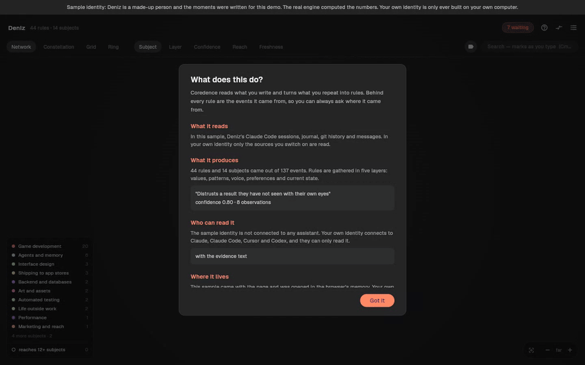

# Coredence

**Your mind's digital twin.**

Coredence reads what you have already written, consolidates it into memories
about how you actually work, and keeps every one of them tied to the traces it
came from. The result lives in a single file on your own machine.

→ **[coredence.com](https://coredence.com)** · **[Try it in your browser](https://coredence.com/deneme)** — the real window on a made-up person's mind, nothing to install



---

## What this repository is

Releases, documentation and the issue tracker. **Not the source.**

The engine that reads your work is not published. The reason, and what you get
instead, is written out on [coredence.com/license](https://coredence.com/license) —
but the short version is that the claims worth checking are checkable without
it, and more conclusively:

```sh
lsof -i -a -p $(pgrep -x Coredence)      # prints nothing: the window opens no sockets
sqlite3 ~/.coredence/coredence.db '.tables'  # your whole mind, in a tool we did not write
```

Source code tells you what should happen. Those tell you what is happening.

One connection exists and it is worth stating plainly: while it is
consolidating, the engine calls the model you chose — your Claude Code, your API
key, or a server on your own machine. That is the only thing that leaves, it
happens only during a cycle, and the last of those three options removes it
entirely.

## Status

Released. The current version is on the [releases
page](../../releases/latest), signed with a Developer ID and notarised by
Apple.

**Watch this repository** (Watch → Custom → Releases) and GitHub will tell you
when the next one lands. There is no mailing list, because there is no account
and nothing to put you in one.

## Getting it

One download from the [releases page](../../releases/latest) or from
[coredence.com](https://coredence.com) — macOS 14 or later, Apple silicon. The engine ships inside the app
— nothing to clone, no Python to install, no command to run.

On first launch it asks two things: where it should think, and what to call
you. Reading your work needs a language model and the download does not include
one, so you point it at the Claude Code you already have, at an API key of your
own, or at any OpenAI-compatible server — including a model running on your own
machine.

Windows works too — the engine, the installer and the window all ship.
A mind is one file and moves between machines with you.

Already use an MCP client? Coredence is in the official [MCP
Registry](https://registry.modelcontextprotocol.io) as
`io.github.coredence/coredence`. The server is read-only: it answers questions
about a mind the app has already built on your machine.

## Handing it to an assistant

The mind is more useful inside the tools you already work in than in a window
of its own. Coredence ships an MCP server, so an assistant can ask what you
think about a subject and what any single memory was drawn from, rather than
being handed a file.

It runs on your machine — the client starts it and talks to it over a pipe, so
there is no account, no key and nothing listening on a port. It is read-only,
and that is mechanical rather than a promise: the connection opens the database
read-only, so SQLite itself refuses a write. An assistant can quote your mind
and disagree with it, but deciding who you are stays with you.

For Claude Desktop it ships as a desktop extension — `coredence-<version>.mcpb`
on the [releases page](../../releases/latest), five read-only tools:

| Tool | What it answers |
|------|-----------------|
| `identity` | The whole mind, layer by layer |
| `rules` | Memories of what this person does or values on a given subject |
| `evidence` | The real moments a memory rests on |
| `axes` | How they choose when nothing has been said |
| `topics` | The cortices: the subjects they work on |

The app connects the assistants it finds on your machine during setup. To add
Coredence from an assistant instead, this repository is also a plugin and an
extension. Install the app first, then open it once, so that the `coredence`
command exists; the plugin only starts it with `coredence mcp`.

```sh
# Claude Code
/plugin install coredence --marketplace coredence/coredence

# Claude Code before 2.1.275: add the marketplace, then install
/plugin marketplace add coredence/coredence
/plugin install coredence@coredence

# Codex
codex plugin marketplace add coredence/coredence

# Gemini CLI
gemini extensions install https://github.com/coredence/coredence
```

VS Code and GitHub Copilot read the same plugin (`plugin.json`, `mcp.json`).
What the plugin runs is the read-only server above and nothing else; it carries
no code of its own.

From a terminal, `coredence connect <client>` writes the configuration for
you — Claude Code, Cursor, VS Code, Windsurf, JetBrains, Codex and Gemini CLI
are known by name.

Assistants do not always call an MCP server on their own, so the mind can also
be handed over directly:

- **As an instructions file** — Codex (`~/.codex/AGENTS.md`), Gemini CLI
  (`~/.gemini/GEMINI.md`) and VS Code with Copilot
  (`~/.copilot/copilot-instructions.md`) read one every session. Coredence
  writes its own marked section and refreshes it every cycle, leaving the rest
  of the file alone. Settings › Assistants, or `coredence instructions <name> --on`.
- **To chat assistants** — Claude, ChatGPT and Gemini chats take it through their
  own memory import or custom instructions. Settings › Assistants › *Copy and
  open* copies your strongest memories at the length each one accepts and opens
  the right page; you paste. Nothing is sent from the app.

## Documentation

- [Getting started](https://coredence.com/docs) — what it reads, what the five
  layers mean, what to do with a memory you disagree with
- [Privacy](https://coredence.com/privacy) — what is collected (nothing) and
  how to verify that rather than believe it
- [Security](https://coredence.com/security) — signing, notarisation, and how
  to check a build before you open it
- [Roadmap](https://coredence.com/roadmap) — what is next, and what has been
  decided against

## Issues and questions

Both belong here. Nothing is triaged in private, and there is no support
address that goes somewhere different from where the work is.

For anything that should not be public, open a
[private security advisory](../../security/advisories/new) instead.

---

Made by Akaya Labs.
